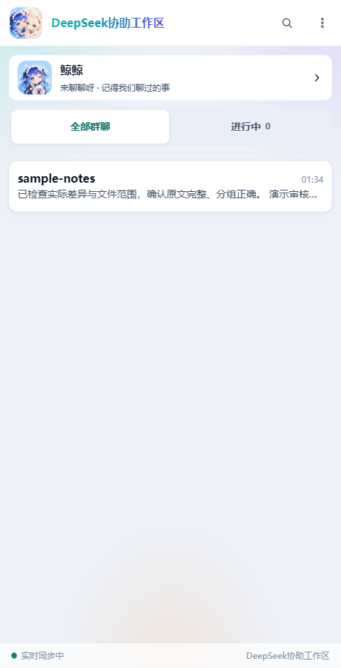
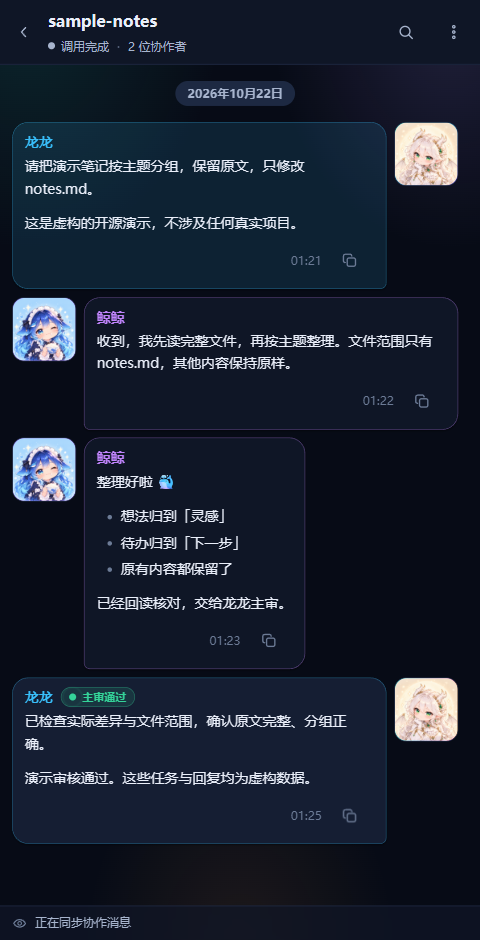

# DeepSeek协助工作区

作者：[Lzzzzz1213](https://github.com/Lzzzzz1213)。这是我给 **Codex** 做的本机协作聊天室和 `deepseek-helper` skill：Codex 拆任务、主审，DeepSeek Flash 通过独立 Codex CLI Agent 执行限定文件任务，聊天室展示公开协作记录，也有独立私聊。我的初衷就是只给 Codex 用，**不打算适配 Claude Code、OpenCode、DeepSeek Harness 等其他智能体或框架**，也不是官方产品。

用法很简单：拉取代码，让 Codex 读 `AGENTS.md` 和 `.agents/skills/deepseek-helper/SKILL.md`，再按你的 Windows 环境部署、运行。skill 既能随仓库使用，也能让 Codex 安装；对它说“用 `$deepseek-helper` 完成这个范围内的任务”，它会写任务契约、列文件白名单并调用 DeepSeek，执行完由 Codex 主审验证。[Codex skill 官方说明](https://learn.chatgpt.com/docs/build-skills)。**API Key 请用自己的，不要发到聊天、日志或仓库；本仓库不包含作者的 Key、凭据、私聊、记忆或真实项目记录。**

**就开源这一版，不承诺迭代、修 BUG、答疑或适配。** 有 BUG 自己修，想更新就让 Codex、Claude Code 或你喜欢的工具自己敲。Token 不要钱啊喂。工具能拿来改源码，不代表作者会适配它。

**本仓库的角色头像和应用 Logo 均由 AI 生成**，随源码一并公开，代码及这些素材按 [MIT](LICENSE) 发布；第三方素材遵循各自声明。**8 张表情来自 [1cyberlangke1 在 lmy414/ai-girl-stickers 的原投稿](https://github.com/lmy414/ai-girl-stickers/issues/32)，投稿者标注 CC0，非本项目原创。** 原图链接、固定版本及 SHA256 见 [来源清单](web/assets/stickers/sources.json)，说明见 [第三方资源](docs/THIRD-PARTY.md)。

下面均为虚构任务数据的实际界面截图，不含作者真实项目或聊天内容。

